# GooseText 4.0

**Тексты с гусем.** Заметки, конспекты, сценарии, рисунки и напоминания — с проверкой
ошибок, пересказом своими словами, переводом, AI-озвучкой, планом текста, папками
и маскотом-гусём Гошей.

Интерфейс — в духе рабочей среды DeepSeek Harness: компактная строка заголовка,
боковые рэйлы с кнопками, панель документов слева, панель помощника справа
и единый рабочий холст. Цвета остались оранжево-белыми, логотип — новый:
буква G, верх которой стал головой гуся.

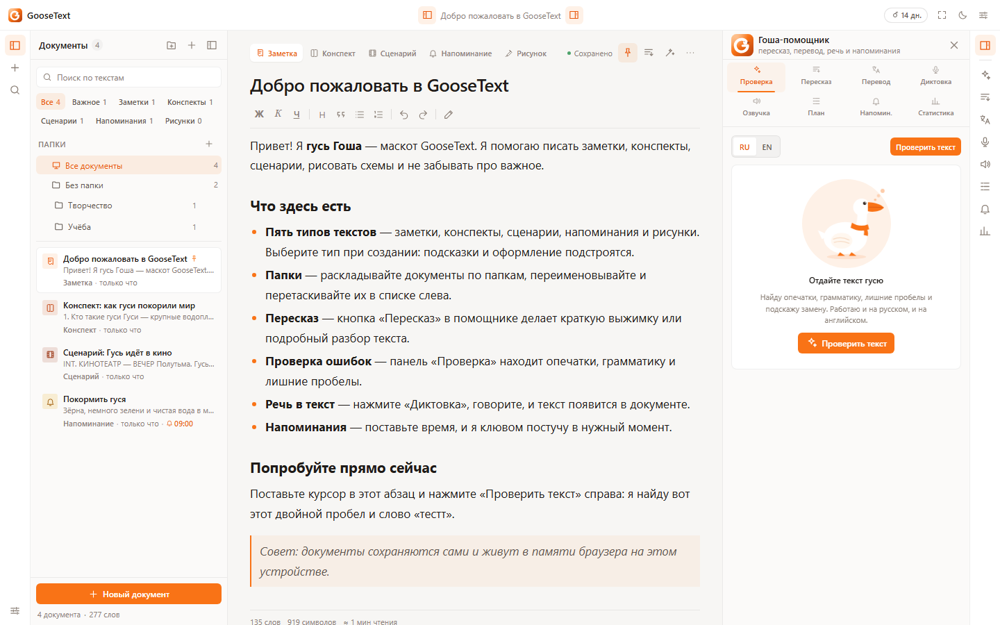

- **Windows** — настольное приложение (Electron): своё окно, ярлыки, установщик и портативная версия.
- **Android** — приложение в APK и та же кодовая база как PWA: ставится на телефон, работает офлайн.

> **Нумерация.** Релиз на GitHub называется **v1.0** — это первый публичный выпуск.
> Версия самого приложения — **4.0**: она видна в «Настройки → О программе», в имени
> установщика и в APK (в именах файлов — `4.0.0`).

## Скачать

| Платформа | Файл | Что это |
| --- | --- | --- |
| **Windows** | [GooseText-Setup-4.0.0.exe](https://github.com/igorrais82/GooseText/releases/download/v1.0/GooseText-Setup-4.0.0.exe) | Установщик: ярлыки в «Пуск» и на рабочем столе, удаление через «Параметры → Приложения» |
| **Windows** | [GooseText-4.0.0-portable.exe](https://github.com/igorrais82/GooseText/releases/download/v1.0/GooseText-4.0.0-portable.exe) | Портативная версия: один файл, ничего не устанавливает |
| **Android** | [GooseText-4.0.0.apk](https://github.com/igorrais82/GooseText/releases/download/v1.0/GooseText-4.0.0.apk) | APK для телефона и планшета, Android 6.0 и новее |

Все файлы — на [странице релиза v1.0](https://github.com/igorrais82/GooseText/releases/tag/v1.0).

---

## Что нового в 4.0

| Возможность | Что сделано |
| --- | --- |
| **Android-приложение** | Полноценный APK на Capacitor: свой значок и заставка, офлайн-запуск, доступ к файлам, микрофон и уведомления. Ставится без магазина приложений. |
| **Версия 4.0** | Линейка продолжилась после прототипа 0.4: сборки Windows и Android из одного коммита, версия видна в «Настройки → О программе». |
| **Версия в интерфейсе** | Строка «О программе» берёт номер из `package.json`, поэтому сборки больше не расходятся с документацией. |
| **Скрипты сборки** | `pnpm android:sync` и `pnpm android:apk` — сборка APK одной командой. |

Всё, что появилось в 0.4, тоже здесь:

| Возможность | Что сделано |
| --- | --- |
| **Перевод** | Новая вкладка: 15 языков, автоопределение, перевод всего документа или выделения, вставка в текст и сохранение отдельным документом. |
| **AI-озвучка** | Текст читает нейроголос, а не только системный синтез: выбор языка, скорость, пауза, а также скачивание готового MP3. |
| **Диктовка в приложении** | Раньше работала только в браузере. Теперь в Windows-приложении используется локальная модель Whisper: первый запуск скачивает её один раз, дальше распознавание идёт на устройстве. |
| **Пересказ** | Полностью переписан: TextRank, сжатие предложений, удаление вводных и придаточных, замена повторов местоимениями. Это пересказ, а не копия исходных фраз. |
| **План и метрики** | Структура текста, ключевые слова, индекс читаемости и подсказки, что улучшить. |
| **Стили** | Шесть действительно разных оформлений: стандартный, минималистичный, реалистичный, детальный, контрастный и мягкий. |
| **Новый логотип** | Знак «G-гусь» и полный набор иконок: `.ico` для Windows, PNG 192/512 и maskable для Android, `favicon.svg`. |
| **Своя строка заголовка** | Системная белая полоса Windows убрана: заголовок, кнопки свернуть/развернуть/закрыть и фон окна перекрашиваются вместе с темой. |

---

## Установка на Windows

| Что | Где |
| --- | --- |
| Установленное приложение | `%LOCALAPPDATA%\Programs\GooseText\GooseText.exe` |
| Установщик (для другого ПК) | `release/GooseText-Setup-4.0.0.exe` — [скачать](https://github.com/igorrais82/GooseText/releases/download/v1.0/GooseText-Setup-4.0.0.exe) |
| Портативная версия | `release/GooseText-4.0.0-portable.exe` — [скачать](https://github.com/igorrais82/GooseText/releases/download/v1.0/GooseText-4.0.0-portable.exe) |
| Ярлык в проекте | [`GooseText.lnk`](GooseText.lnk) |

Сами `.exe` и `.apk` в репозиторий не кладутся (слишком большие) — они лежат
в [разделе Releases](https://github.com/igorrais82/GooseText/releases/tag/v1.0); после
`pnpm desktop:dist` они появляются в `release/`.

Установщик ставит приложение только для текущего пользователя (администратор не нужен),
создаёт ярлыки на рабочем столе и в меню «Пуск». Удаление — «Параметры → Приложения → GooseText».
При обновлении документы, папки и лицензия сохраняются.

Документы и настройки лежат в `%APPDATA%\GooseText` и сохраняются при переустановке.
Модель распознавания речи при первом запуске диктовки скачивается туда же
(`%APPDATA%\GooseText\model-cache`) и потом работает без интернета.
Резервная копия — «Настройки → Данные → Экспорт».

---

## Установка на Android

1. Скачайте [`GooseText-4.0.0.apk`](https://github.com/igorrais82/GooseText/releases/download/v1.0/GooseText-4.0.0.apk)
   на телефон (или скачайте на компьютер и перекиньте файл).
2. Откройте файл в «Загрузках». Android спросит разрешение на установку из этого источника —
   разрешите его для «Файлов» или браузера.
3. Нажмите «Установить». Ярлык **GooseText** появится на главном экране.

- APK собран и подписан релизным ключом, но **не опубликован в Google Play**,
  поэтому система предупредит про установку из неизвестного источника — это нормально.
- Нужен Android 6.0 и новее, файл занимает меньше 4 МБ.
- Документы и настройки хранятся на устройстве; перенос — «Настройки → Данные → Экспорт».
- Работает офлайн: оболочка, пересказ, план, рисунки, папки и лицензия. Интернет нужен
  для проверки ошибок, перевода и AI-озвучки.

---

## Интерфейс

| Элемент | Что делает |
| --- | --- |
| **Строка заголовка** | Знак и название, переключатели панелей, название документа, статус лицензии, полный экран, тема, настройки. В приложении — свои кнопки свернуть/развернуть/закрыть. |
| **Левый рэйл** | Документы, новый документ, поиск, настройки. |
| **Панель документов** | Поиск, фильтры по пяти типам, дерево папок, список документов, счётчики, кнопка нового документа. |
| **Рабочий холст** | Тип документа, заголовок, напоминание, форматирование или холст рисунка, статистика. |
| **Правый рэйл** | Проверка, пересказ, перевод, диктовка, озвучка, план, напоминания, статистика. |
| **Панель помощника** | Вкладки «Проверка», «Пересказ», «Перевод», «Диктовка», «Озвучка», «План», «Напоминания», «Статистика». |
| **Мобильная панель** | Внизу: документы, новый, пересказ, проверить, помощник. Панели открываются поверх текста. |

Горячие клавиши: `Ctrl+1` — документы, `Ctrl+2` — помощник, `Ctrl+3` — пересказ,
`Ctrl+4` — перевод, `Ctrl+5` — озвучка, `Ctrl+6` — план, `F11` — полный экран.

---

## Пересказ

Вкладка «Пересказ» работает офлайн и не отправляет текст в сеть.

- **TextRank** находит смысловые предложения, а не просто частые слова.
- **Компрессор** убирает вводные обороты, придаточные, примеры и повторы.
- Повторяющееся подлежащее заменяется местоимением, поэтому текст не выглядит копией.
- **Кратко** — 2–4 главных предложения и список «Главное».
- **Подробно** — «Коротко», «Главные мысли», «Ключевые понятия» и «Итог».

Результат можно скопировать или сохранить отдельным документом-конспектом
(он попадёт в ту же папку, что и исходник).

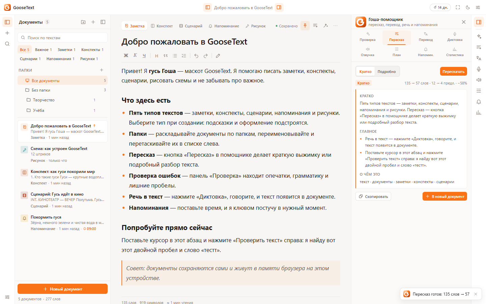

---

## Перевод

Вкладка «Перевод» переводит текст на 15 языков: английский, немецкий, французский,
испанский, итальянский, португальский, турецкий, украинский, польский, казахский,
китайский, японский, корейский и арабский.

- Язык источника определяется автоматически (кириллица, латиница, CJK).
- Можно перевести весь документ или только выделенный фрагмент.
- Длинный текст режется на абзацы автоматически.
- Перевод вставляется в документ или сохраняется отдельной заметкой.
- Основные сервисы — Google Translate и MyMemory; без интернета для пары
  русский ↔ английский работает офлайн-словарь (черновой перевод).

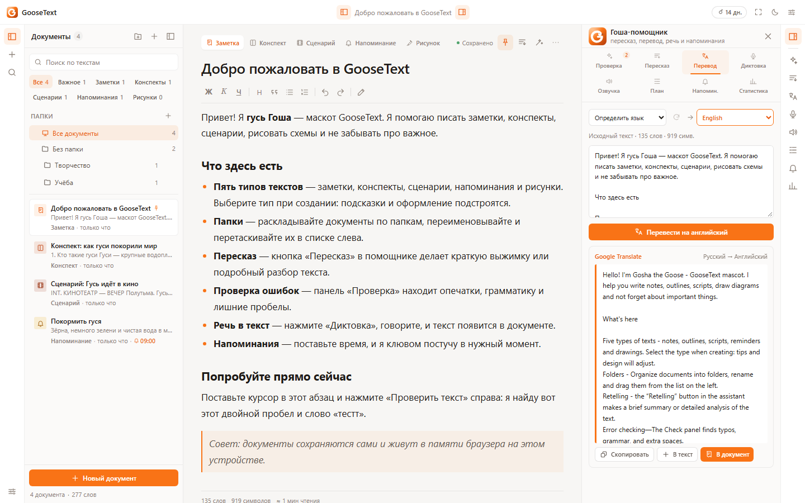

---

## AI-озвучка

Вкладка «Озвучка» читает текст вслух.

- **AI-голос** — нейроголос Google: естественная интонация и 15 языков.
- **Системный голос** — голоса Windows, работает офлайн.
- Пауза, продолжение, скорость 0.7–1.5×, чтение выделенного фрагмента.
- **Скачать MP3** — готовая озвучка сохраняется файлом, её можно слушать в плеере
  или отправить в мессенджер.
- Если прокси озвучки недоступен, интерфейс сам предложит системный голос.

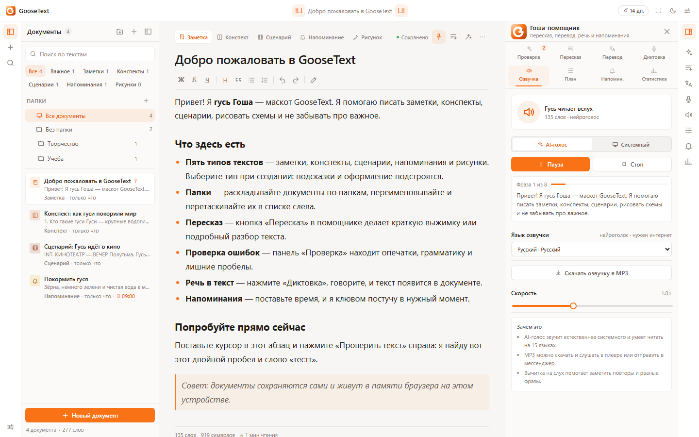

---

## Диктовка

Диктовка работает и в браузере, и в настольном приложении.

- **В Chrome и Edge** используется быстрое распознавание браузера.
- **В приложении для Windows** — локальная модель Whisper (ONNX + WASM). Она
  скачивается при первом запуске (около 60 МБ), кэшируется в профиле приложения
  и дальше работает офлайн. Звук не покидает устройство.
- Языки: русский и английский; текст дописывается в конец документа.
- Движок выбирается в настройках или прямо во вкладке: «Автоматически»,
  «Браузерное распознавание», «Локальная модель Whisper».

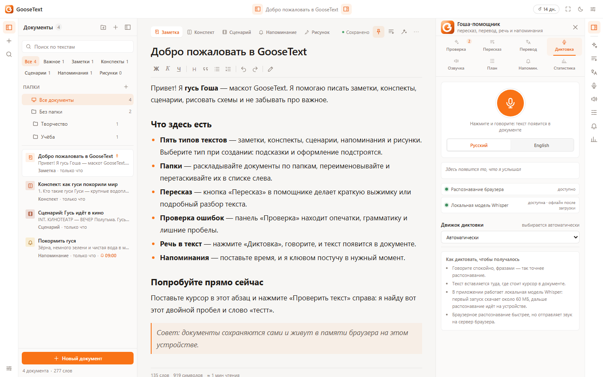

---

## План и метрики

Вкладка «План» разбирает текст без отправки в сеть:

- структура: заголовки или первые фразы абзацев;
- ключевые слова с частотой;
- индекс читаемости, средняя длина предложения, доля служебных слов;
- подсказки: разбить длинные предложения, убрать воду, добавить подзаголовки;
- план вставляется в текст или сохраняется отдельным документом.

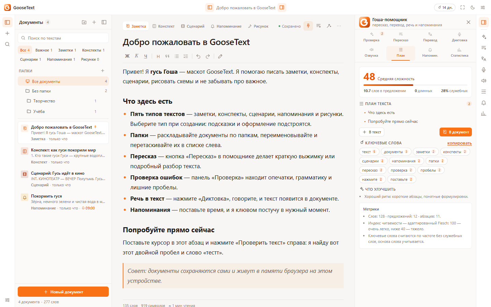

---

## Рисунок

Пятый тип документа открывает холст 1000 × 750 (4:3): перо с чувствительностью к нажатию
стилуса, полупрозрачный маркер, ластик, палитра из семи цветов, четыре толщины, сетка,
отмена и повтор штрихов. Рисунок хранится как список штрихов, а не как картинка:
его можно править, он не занимает много места и не зависит от разрешения экрана.
Кнопка **PNG** собирает картинку 1600 px по ширине с фоном (экспорт входит в лицензию).

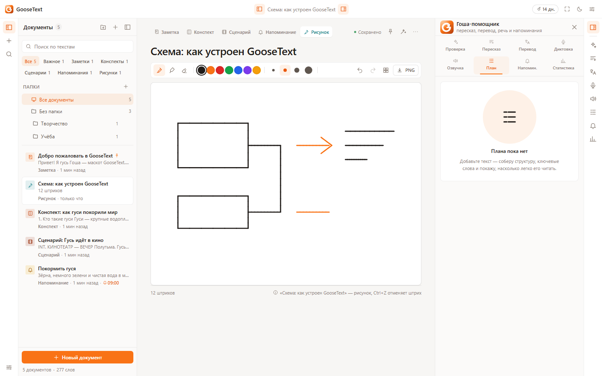

---

## Папки

Папки живут в левой панели под фильтрами. Вложенность любая, вложенные папки
сворачиваются стрелкой.

- **Создать** — кнопка с плюсом в шапке панели или у заголовка «Папки».
- **Переименовать** — двойной щелчок по имени или меню «…».
- **Переместить** — перетащить документ на папку, папку на папку (вложенность) или
  в «Без папки» / «В корень». На телефоне и для точного выбора есть диалог
  «Переместить в…».
- **Удалить** — документы и вложенные папки не пропадают, а поднимаются на уровень выше.


---

## Лицензия

| Вариант | Цена | Что даёт |
| --- | --- | --- |
| Пробный период | 0 ₽, 14 дней | Все возможности, включая подробный пересказ и PNG |
| На год | **149 ₽** | Без лимита документов и папок, подробный пересказ, экспорт PNG |
| Навсегда | **349 ₽** | То же плюс обновления навсегда |

Без лицензии после пробного периода остаются 30 документов, 5 папок, краткий пересказ
и рисование. **Данные не удаляются**: лишние документы просто нельзя создавать,
пока лимит не освободится или не появится лицензия.

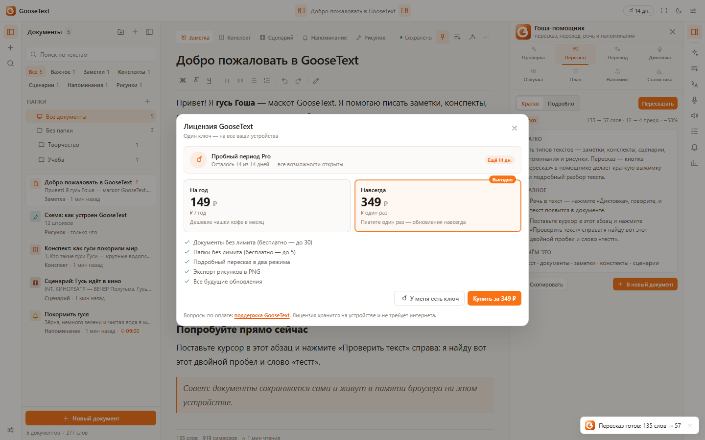

Статус лицензии и лимиты всегда видны в «Настройки → Лицензия».

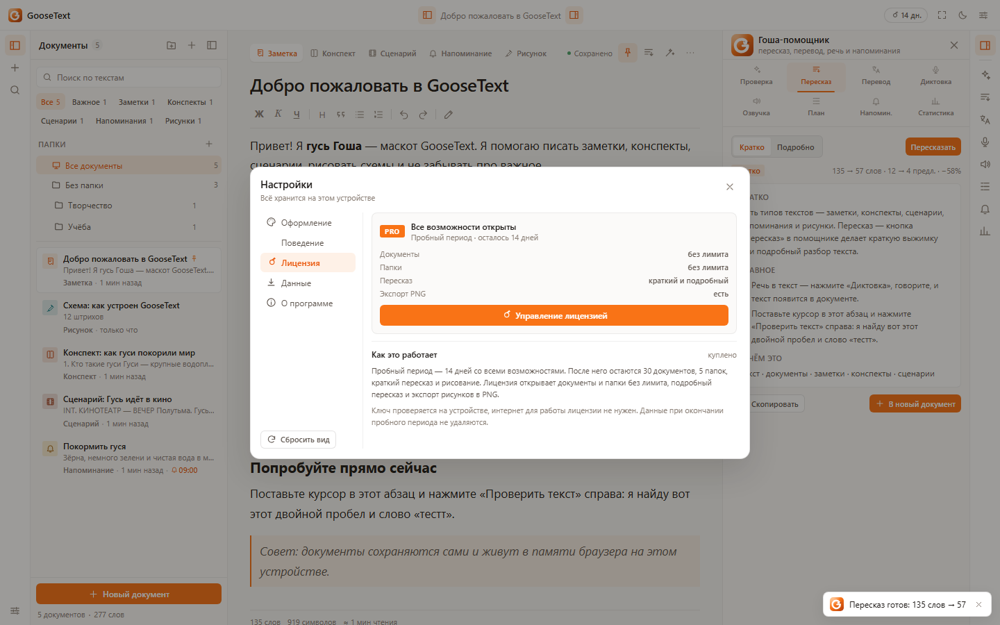

### Как это устроено в прототипе

Платёжный провайдер **не подключён**: кнопка «Купить» показывает полный путь покупки,
но деньги не списывает. Ключ проверяется на устройстве по контрольной сумме
(`GTXT-XXXXX-XXXXX-XXXXX`), интернет для активации не нужен.

В окне активации есть **демонстрационный ключ** — он подходит только для проверки
интерфейса. Чтобы продавать по-настоящему, нужно:

1. Подключить провайдера (ЮKassa, CloudPayments, Robokassa, СБП) и создать платёжную ссылку.
2. На сервере принимать webhook об оплате и выдавать ключ, привязанный к e-mail или устройству.
3. Заменить `CHECKOUT_URL` и блок демо-ключа в `src/components/LicenseDialog.tsx`,
   а проверку ключа в `src/lib/license.ts` — на подписанный сервером токен.
4. Подготовить оферту, условия возврата и чеки по 54-ФЗ.

Цены в интерфейсе — черновик: перед продажей их стоит сверить с рынком и текстом оферты.

---

## Оформление и настройки

Настройки открываются шестерёнкой (`Ctrl+,`). Слева — разделы, справа — параметры:
оформление, поведение, лицензия, данные, о программе.

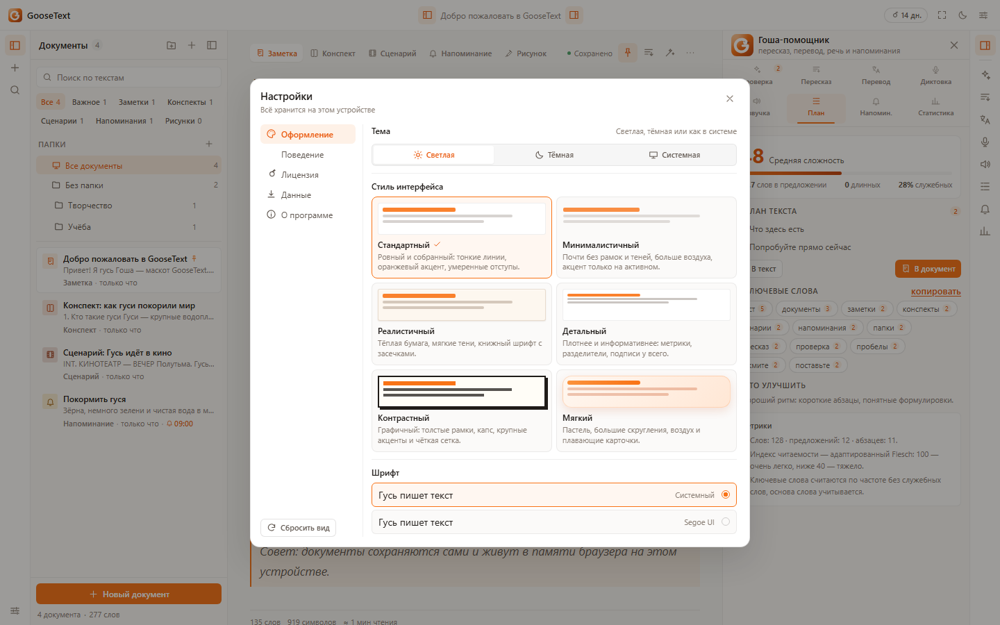

**Тема** — светлая, тёмная или системная. Строка заголовка и фон окна меняются вместе с ней.

**Стиль интерфейса** — шесть вариантов, и они действительно разные:

- **Стандартный** — ровный, тонкие линии, оранжевый акцент.
- **Минималистичный** — без рамок и теней, монохромный акцент, больше воздуха.
- **Реалистичный** — тёплая бумага, книжный шрифт с засечками, мягкие тени.
- **Детальный** — плотнее, капс-подписи, моноширинные цифры, пунктирные разделители.
- **Контрастный** — толстые рамки, жёсткие тени, графичные акценты.
- **Мягкий** — пастель, большие скругления и плавающие карточки.

| Тёмная тема | Реалистичный стиль | Детальный стиль |
| --- | --- | --- |
| 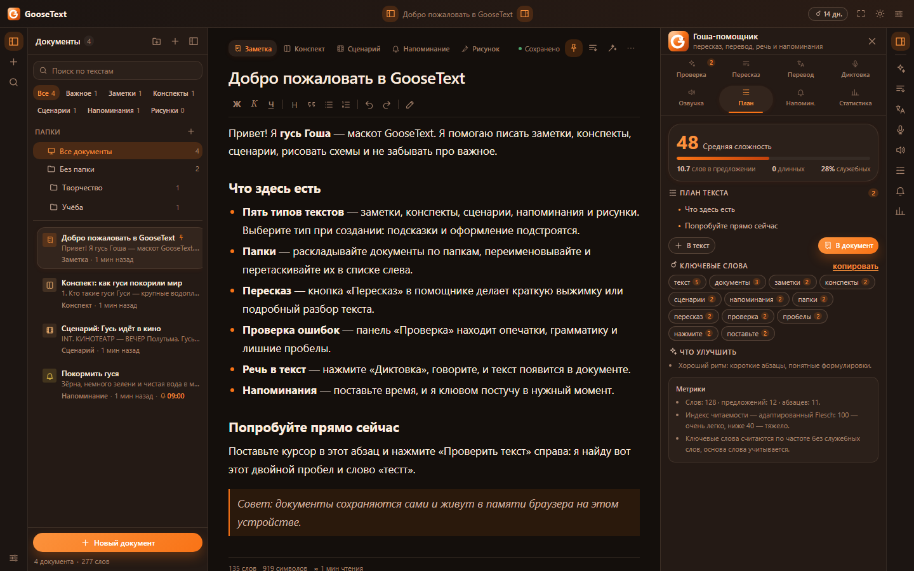 | 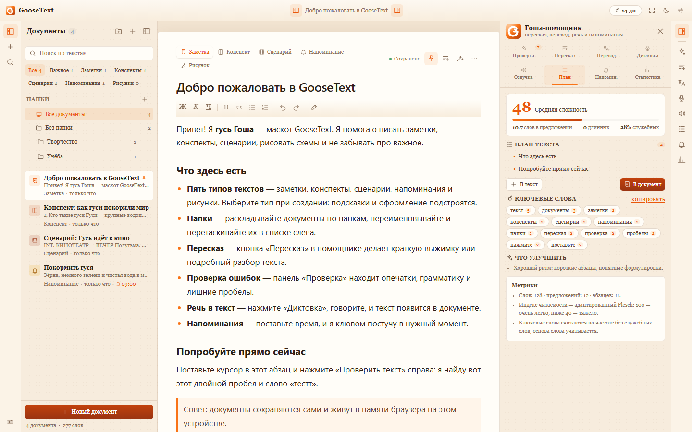 | 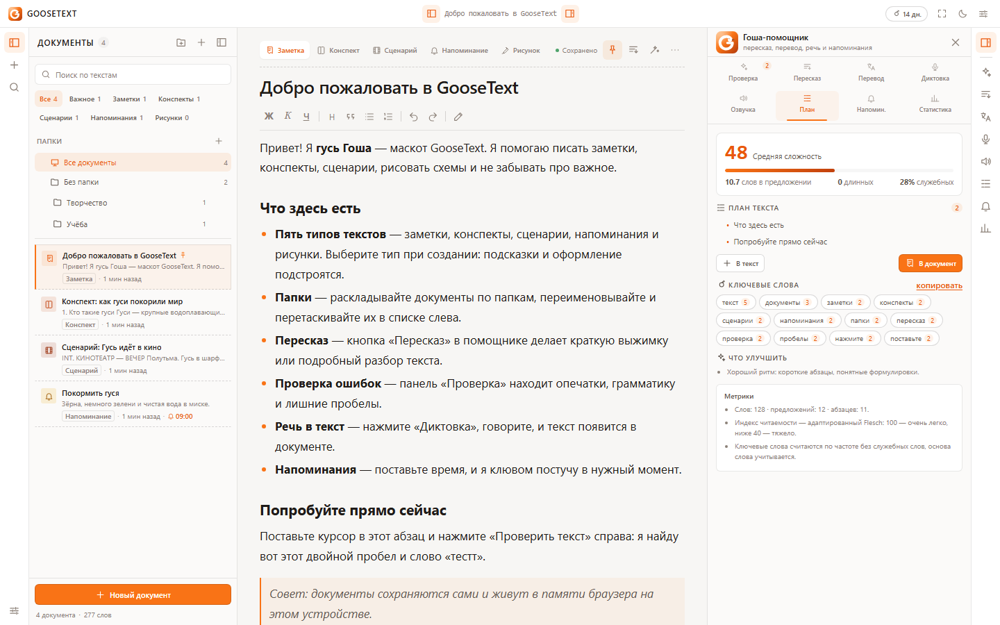 |

| Минималистичный | Контрастный | Мягкий |
| --- | --- | --- |
| 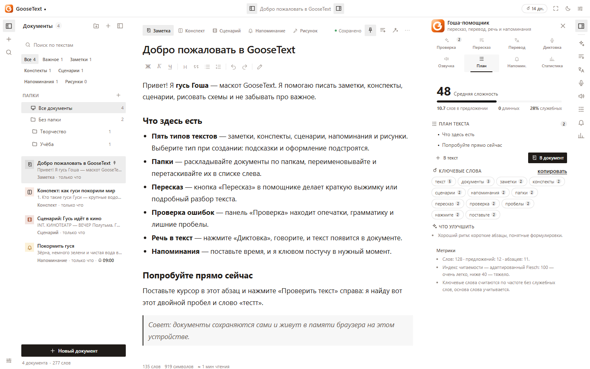 | 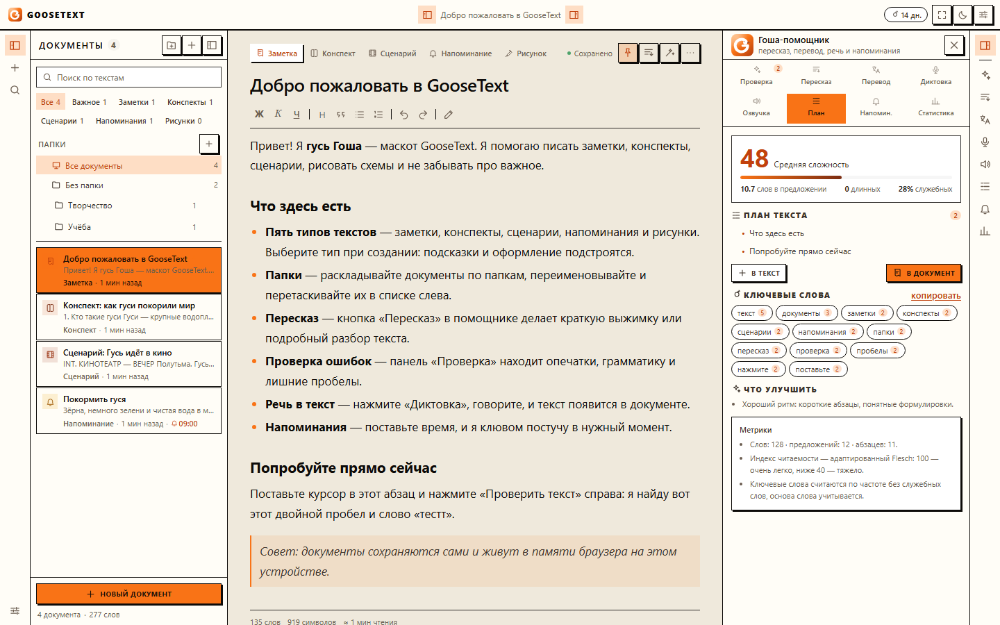 | 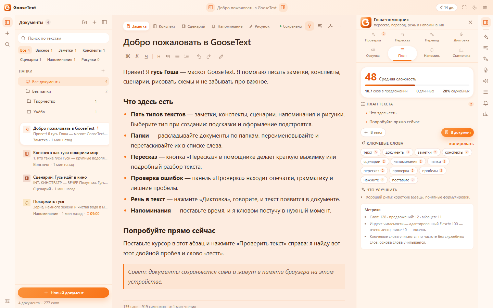 |

**Шрифт** — системный, Segoe UI, Georgia (с засечками) или Consolas (моно);
размер текста 13–24 px, межстрочный интервал 1.4–2.2.

---

## Что уже умеет

| Возможность | Как работает |
| --- | --- |
| **5 типов документов** | Заметка, конспект, сценарий, напоминание, рисунок. Тип меняется у готового документа. |
| **Папки** | Дерево с переименованием и перемещением, документы и папки перетаскиваются мышью. |
| **Редактор** | Жирный/курсив/подчёркнутый, заголовки, цитаты, списки, отмена и повтор. Автосохранение. |
| **Режим сценария** | Строки `INT. КОМНАТА — ДЕНЬ`, имена героев капсом, реплики и ремарки оформляются автоматически. |
| **Проверка ошибок** | Русский и английский, опечатки, грамматика, повторы, лишние пробелы; замена в один клик. |
| **Пересказ** | Краткий и подробный режимы, сжатие с переформулировкой, сохранение в новый документ. |
| **Перевод** | 15 языков, автоопределение, выделение, вставка и сохранение. |
| **AI-озвучка** | Нейроголос и системный голос, пауза, скорость, экспорт MP3. |
| **Диктовка** | Браузерное распознавание и локальный Whisper в приложении. |
| **План и метрики** | Структура, ключевые слова, читаемость, советы. |
| **Рисование** | Перо, маркер, ластик, палитра, сетка, отмена, экспорт PNG. |
| **Напоминания** | Время у документа, список ближайших, «+10 минут», звук гуся и системное уведомление. |
| **Поиск и фильтры** | Поиск по заголовкам и содержимому, фильтры по типам, закрепление важного, фильтр по папке. |
| **Статистика** | Слова, символы, время чтения, сводка по библиотеке. |
| **Экспорт** | `.txt` и `.md` для документа, PNG для рисунка, MP3 для озвучки, резервная копия всей библиотеки в `.json` и импорт. |
| **Полный экран** | Кнопка в шапке и F11; окно Electron разворачивается без рамки. |
| **Лицензия** | Пробный период, магазин, активация ключом, лимиты бесплатной версии. |
| **Маскот** | Гусь Гоша на SVG: думает, слушает, спит и радуется. |

Данные хранятся локально, без аккаунтов и облака.

---

## Браузерная версия и PWA

```powershell
pnpm install
pnpm build          # собрать dist/
pnpm app            # локальный сервер на http://127.0.0.1:5180
```

- **Windows, браузер:** двойной щёлчок по [`GooseText-web.cmd`](GooseText-web.cmd).
- **Android без APK:** откройте адрес в Chrome → меню → «Установить приложение». GooseText появится
  на главном экране и заработает офлайн. APK удобнее, если телефон не в одной сети с компьютером.

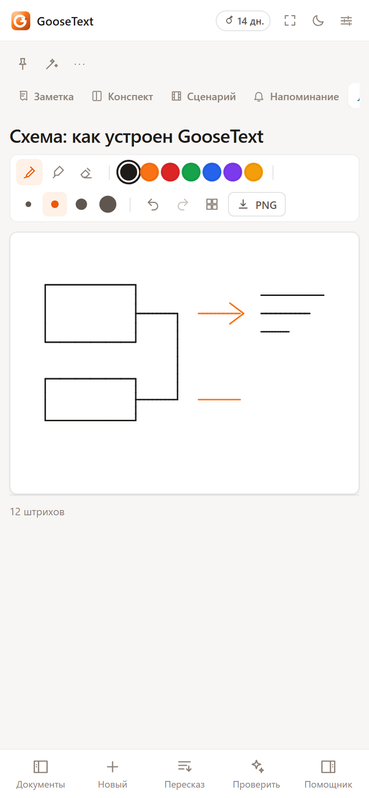 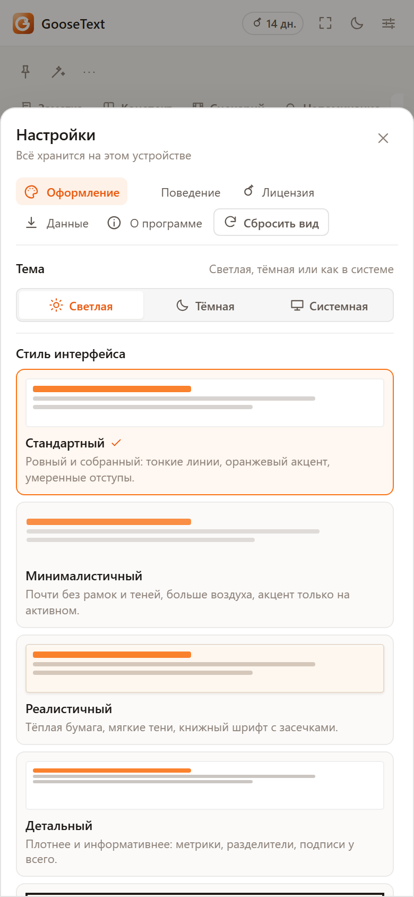

---

## Разработка

```powershell
pnpm install
pnpm dev                 # Vite с горячей перезагрузкой, http://127.0.0.1:5180
pnpm desktop:dev         # окно Electron поверх dev-сервера (GOOSETEXT_DEV_URL)
pnpm build               # сборка интерфейса в dist/
pnpm desktop:pack        # распакованное приложение в release/win-unpacked
pnpm desktop:dist        # установщик NSIS + портативная версия в release/
pnpm android:sync        # пересобрать интерфейс и скопировать его в android/
pnpm android:apk         # собрать подписанный APK
pnpm typecheck           # проверка типов
```

### Сборка Android

APK собирается проектом `android/` (Capacitor 7) и требует Android SDK и JDK 17+.

```powershell
$env:ANDROID_HOME = "$env:LOCALAPPDATA\Android\Sdk"
# платформа и инструменты: platforms;android-35, build-tools;35.0.0, platform-tools
```

Подпись читается из `android/keystore.properties` (в репозиторий не попадает —
там же `goosetext-release.jks`):

```properties
storeFile=goosetext-release.jks
storePassword=…
keyAlias=goosetext
keyPassword=…
```

Готовый файл: `android/app/build/outputs/apk/release/GooseText-4.0.0.apk`.
Значок и заставка Android перерисовываются из логотипа:
`python tools/make-android-assets.py`.

### Технологии

- **React 19 + TypeScript + Vite** — интерфейс без UI-библиотек.
- **Собственная дизайн-система** на CSS-переменных: темы, шесть стилей, шрифты, плотность.
- **Electron 45** — настольная оболочка: своя строка заголовка, кнопки окна, установщик NSIS.
- **Capacitor 7** — Android-оболочка: WebView с локальными файлами, значок, заставка, разрешения.
- **PWA**: `manifest.webmanifest` + service worker — установка из браузера, офлайн-оболочка.
- **Проверка текста**: [LanguageTool API](https://languagetool.org/http-api/) плюс локальные правила.
- **Пересказ**: TextRank + компрессия предложений, работает офлайн.
- **Перевод**: Google Translate (gtx) и MyMemory, плюс офлайн-словарь.
- **Озвучка**: нейроголос Google через локальный TTS-прокси + системный `speechSynthesis`.
- **Диктовка**: Web Speech API в Chrome/Edge и **Whisper** (transformers.js, ONNX/WASM) в приложении.
- **Рисунок**: Canvas 2D, штрихи хранятся в логических координатах 1000 × 750.
- **Лицензия**: офлайн-проверка ключа по контрольной сумме (прототип магазина).

### Структура

```
electron/
  main.cjs                окно, своя строка заголовка, разрешения, полный экран
  preload.cjs             мост в страницу
  model-server.cjs        кэш моделей Whisper и прокси AI-озвучки
src/
  App.tsx                 оболочка, состояние, папки, лицензия, горячие клавиши
  styles.css              токены, темы, шесть стилей, компоненты, адаптив
  types.ts                документы, рисунки, папки, лицензия, настройки
  components/
    DocumentsPanel.tsx    документы, фильтры, дерево папок, drag & drop
    EditorPane.tsx        холст текстового документа
    DrawingPane.tsx       холст рисунка, инструменты, экспорт PNG
    AssistantPanel.tsx    проверка, пересказ, перевод, диктовка, озвучка, план
    TranslatePane.tsx     перевод и языки
    SpeakPane.tsx         AI-озвучка и MP3
    OutlinePane.tsx       план, ключевые слова, читаемость
    LicenseDialog.tsx     магазин и активация ключа
    SettingsDialog.tsx    оформление, поведение, лицензия, данные, о программе
    Dialogs.tsx           модальные окна, выбор папки
    Rail.tsx              боковые рэйлы с кнопками
    Goose.tsx             маскот и логотип
    Toasts.tsx            уведомления
    Icon.tsx              иконки
  lib/
    appearance.ts         темы, стили, шрифты, фон окна
    editor.ts             offsets ↔ DOM, вставка, разметка сценария
    draw.ts               штрихи, отрисовка, экспорт PNG
    folders.ts            дерево папок и проверка перемещений
    retell.ts             TextRank + компрессия
    translate.ts          перевод и офлайн-словарь
    tts.ts                AI-озвучка и экспорт MP3
    localSpeech.ts        локальный Whisper
    license.ts            тарифы, ключи, лимиты
    sanitize.ts           очистка импортированного HTML
    spellcheck.ts         LanguageTool + локальные правила
    speech.ts             Web Speech API и системный синтез
    platform.ts           desktop/браузер, окно, модель, полный экран
    storage.ts            сохранение, миграция, импорт/экспорт
    outline.ts            план, ключевые слова и читаемость
    utils.ts              даты, слова, markdown
server/serve.mjs          сервер для браузерной версии и прокси озвучки
android/                  проект Capacitor: MainActivity, значок, заставка, подпись
capacitor.config.ts       appId, имя приложения, папка веб-сборки
tools/                    скриншоты, smoke-тесты, генерация логотипа и иконок Android
assets/goosetext.ico      иконка Windows
public/icons/             иконки PWA
```

---

## Горячие клавиши

| Комбинация | Действие |
| --- | --- |
| `Ctrl+1` | Показать/скрыть документы |
| `Ctrl+2` | Показать/скрыть помощника |
| `Ctrl+3` | Вкладка «Пересказ» |
| `Ctrl+4` | Вкладка «Перевод» |
| `Ctrl+5` | Вкладка «Озвучка» |
| `Ctrl+6` | Вкладка «План» |
| `F11` | Полный экран |
| `Ctrl+,` | Настройки |
| `Ctrl+S` | Сохранить сейчас |
| `Ctrl+N` | Новый документ |
| `Ctrl+K` | Поиск по документам |
| `Ctrl+Enter` | Проверить текст |
| `Ctrl+Z` / `Ctrl+Y` | Отменить / повторить штрих в рисунке |
| `Ctrl+B` / `Ctrl+I` / `Ctrl+U` | Жирный / курсив / подчёркнутый |

---

## Проверки

```powershell
pnpm typecheck
node tools/smoke.mjs               # проверки функций в headless Chrome
node tools/desktop-smoke.mjs       # мост, полный экран и рисунок в окне Electron
node tools/docs-shots.mjs          # обновить скриншоты в docs/screenshots
python tools/make-logo.py          # перерисовать логотип и иконки
python tools/make-android-assets.py # значки и заставки Android
```

---

## Ограничения версии 4.0

- **Оплата не подключена**: лицензия активируется ключом, демо-ключ лежит в окне активации.
- **APK не в Google Play**: ставится вручную, обновления — новым APK поверх старого.
  Ключ подписи лежит только на машине сборки: если он потеряется, обновление потребует
  переустановки приложения.
- **Диктовка в приложении** при первом запуске скачивает модель Whisper (~60 МБ). Дальше
  работает офлайн; качество быстрой модели ниже, чем у больших облачных сервисов.
  На Android диктовка пока использует распознавание браузера/WebView.
- **AI-озвучка** и **перевод** требуют интернета; без сети остаются системный голос
  и офлайн-словарь для русский ↔ английский.
- **Проверка ошибок** обращается к LanguageTool и требует интернета; без сети работают локальные правила.
- **Пересказ** работает локально и не пишет новых фактов: он сжимает и переформулирует
  исходный текст, а не придумывает содержание.
- **Напоминания** срабатывают, пока приложение открыто (в Android-приложении — пока оно в фоне
  или на экране).
- **Синхронизации нет**: данные на одном устройстве, перенос — через экспорт/импорт JSON.
- Windows-сборка **без цифровой подписи**: SmartScreen может спросить подтверждение при первом
  запуске. Android-сборка подписана, но не проверена магазином.

## Что дальше

1. Реальный магазин лицензий: провайдер оплаты, серверная выдача ключей, оферта и чеки.
2. Синхронизация, вложения, вставка рисунков в текстовые документы.
3. Публикация Android-сборки в RuStore и Google Play, обновления через магазин.
4. Локальная диктовка Whisper на Android и распознавание аудиофайлов.
5. Автообновление Windows-версии и цифровая подпись установщика.
