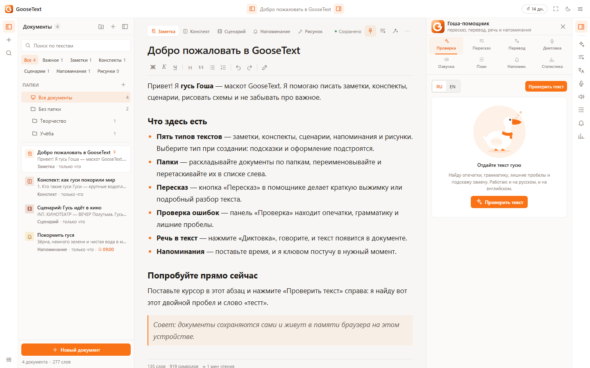
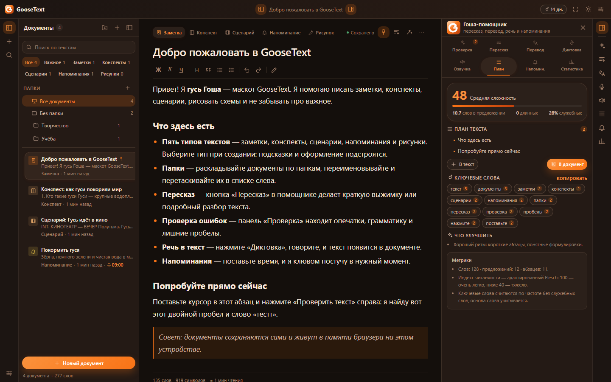
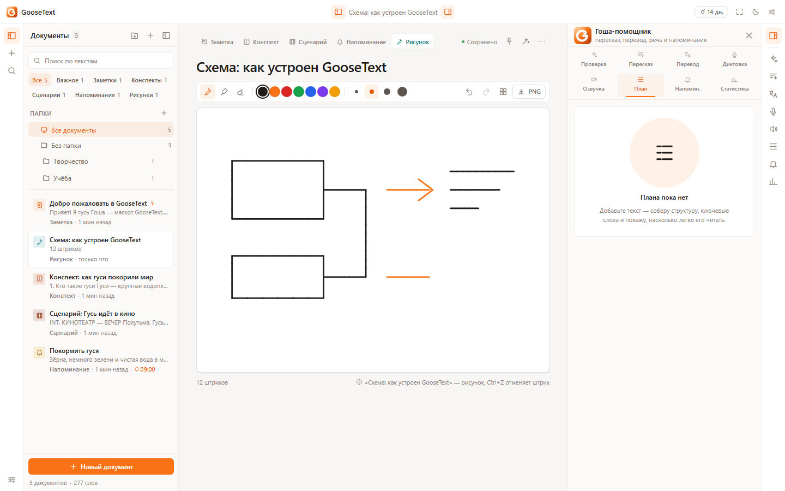
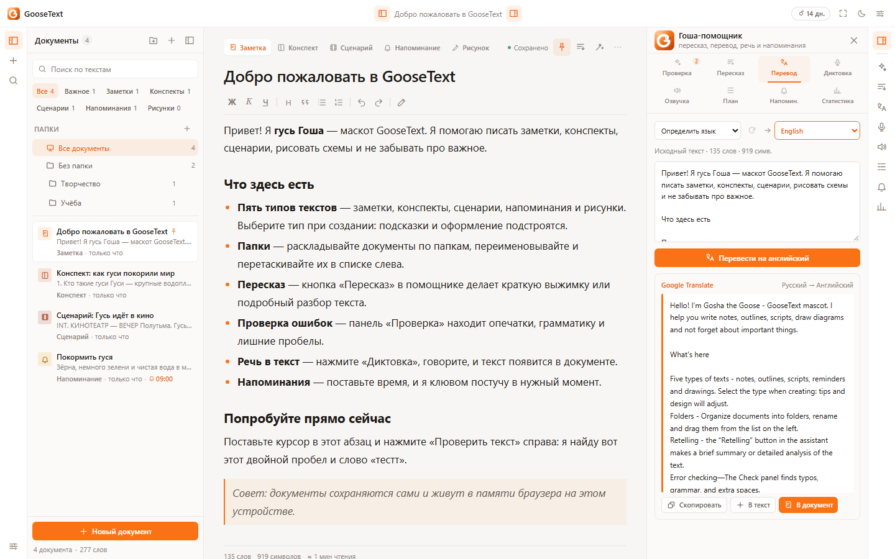
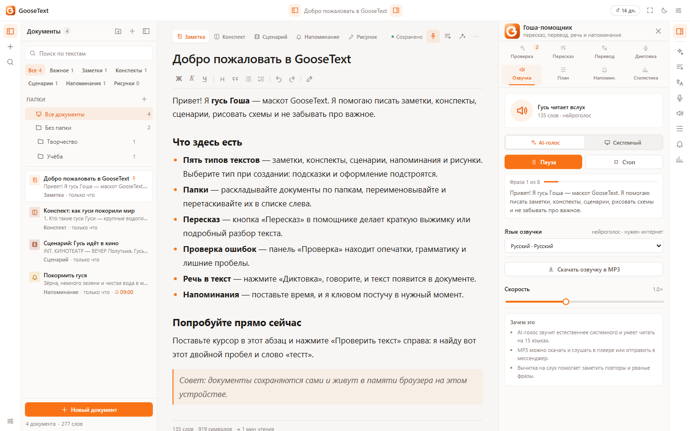
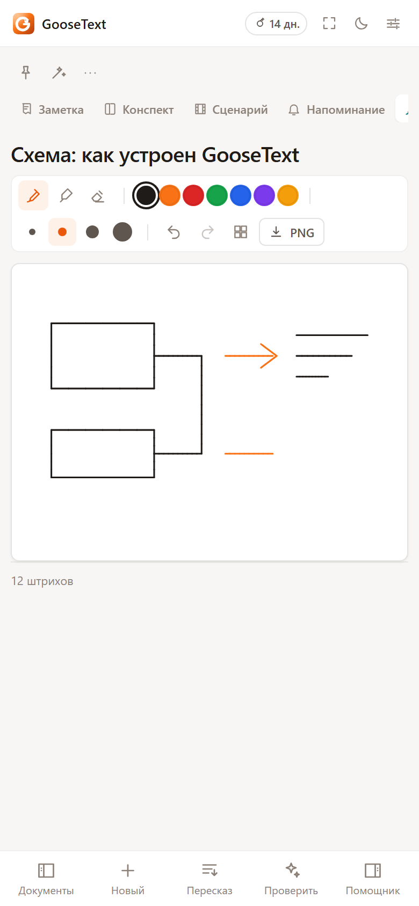
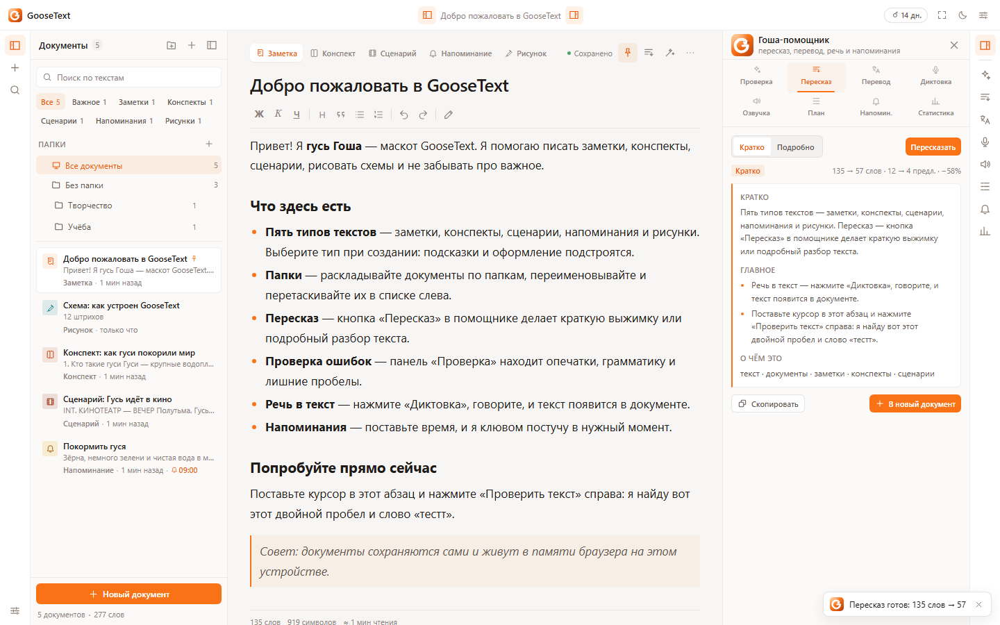
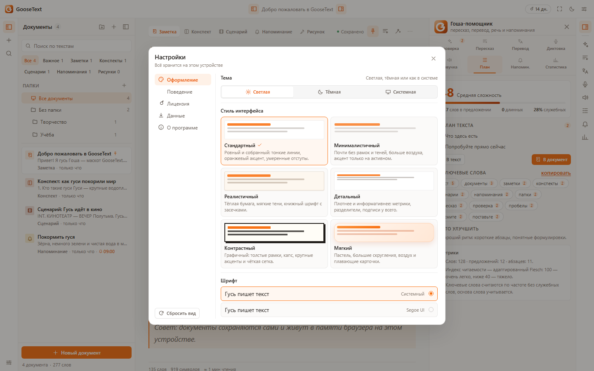

# GooseText 1.0

**Тексты с гусем.** Заметки, конспекты, сценарии, рисунки и напоминания — с проверкой ошибок,
пересказом своими словами, переводом, AI-озвучкой, планом текста, папками и маскотом-гусём Гошей.
Данные хранятся локально, без аккаунтов и облака.

## Что нового в 1.0

- **Android-приложение**: полноценный APK на Capacitor 7 — свой значок и заставка, офлайн-запуск,
  экспорт файлов через системное меню «Поделиться», разрешения на микрофон и уведомления.
- **Стабильная версия**: Windows и Android собираются из одного коммита, единая нумерация версий.
- **Версия в интерфейсе**: «Настройки → О программе» берёт номер из `package.json`.
- **Скрипты сборки**: `pnpm android:sync` и `pnpm android:apk`.

Всё, что появилось в 0.4, тоже здесь: пересказ на TextRank, перевод на 15 языков, AI-озвучка
с экспортом MP3, локальная диктовка Whisper в Windows-версии, план и читаемость, шесть стилей
оформления и новая строка заголовка.

## Скачать

| Платформа | Файл | Размер | Что это |
| --- | --- | --- | --- |
| **Windows 10/11 x64** | **[GooseText-Setup-1.0.0.exe](https://github.com/igorrais82/GooseText/releases/download/v1.0/GooseText-Setup-1.0.0.exe)** | ~117 МБ | Установщик: ярлыки в «Пуск» и на рабочем столе |
| **Windows 10/11 x64** | **[GooseText-1.0.0-portable.exe](https://github.com/igorrais82/GooseText/releases/download/v1.0/GooseText-1.0.0-portable.exe)** | ~106 МБ | Портативная версия: один файл, ничего не устанавливает |
| **Android 6.0+** | **[GooseText-1.0.0.apk](https://github.com/igorrais82/GooseText/releases/download/v1.0/GooseText-1.0.0.apk)** | ~4 МБ | Приложение для телефона и планшета |

### Установка на Windows

Скачайте установщик и запустите. Права администратора не нужны — приложение ставится в профиль
пользователя. Удаление — «Параметры → Приложения → GooseText». Документы лежат в
`%APPDATA%\GooseText` и сохраняются при переустановке.

Сборка не подписана сертификатом, поэтому SmartScreen может попросить подтверждение:
«Подробнее» → «Выполнить в любом случае».

### Установка на Android

1. Скачайте APK на телефон.
2. Откройте файл в «Загрузках» и разрешите установку из этого источника.
3. Нажмите «Установить» — ярлык GooseText появится на главном экране.

APK подписан релизным ключом, но не опубликован в Google Play, поэтому система предупредит
об установке из неизвестного источника — это нормально. Интернет нужен только для проверки
ошибок, перевода и AI-озвучки; заметки, папки, пересказ, план и рисунки работают офлайн.

## Возможности

| | |
| --- | --- |
| **5 типов документов** | Заметка, конспект, сценарий, напоминание, рисунок |
| **Редактор** | Форматирование, заголовки, цитаты, списки, режим сценария, автосохранение |
| **Проверка ошибок** | Опечатки, грамматика, повторы, лишние пробелы; замена в один клик |
| **Пересказ** | TextRank и компрессия предложений: кратко и подробно, офлайн |
| **Перевод** | 15 языков, автоопределение, выделение, вставка и сохранение |
| **Озвучка** | Нейроголос и системный голос, скорость, пауза, экспорт MP3 |
| **Диктовка** | Распознавание браузера и локальный Whisper в Windows-версии |
| **План и метрики** | Структура, ключевые слова, читаемость, советы |
| **Рисование** | Перо, маркер, ластик, палитра, сетка, отмена, экспорт PNG |
| **Папки** | Дерево любой вложенности, перетаскивание, перемещение |
| **Напоминания** | Время у документа, список ближайших, звук и уведомление |
| **Экспорт** | `.txt`, `.md`, PNG, MP3, резервная копия в `.json` и импорт |

## Скриншоты

| Светлая тема | Тёмная тема | Рисунок |
| --- | --- | --- |
|  |  |  |

| Пересказ | Перевод | Озвучка |
| --- | --- | --- |
|  |  |  |

| Телефон | Папки | Настройки |
| --- | --- | --- |
|  |  |  |

## Ограничения

- **Оплата не подключена**: лицензия активируется ключом, демо-ключ лежит в окне активации.
- **APK не в Google Play**: обновления — новым APK поверх старого.
- **AI-озвучка**, **перевод** и **проверка ошибок** требуют интернета; без сети остаются
  системный голос, офлайн-словарь и локальные правила.
- **Синхронизации нет**: данные на одном устройстве, перенос — через экспорт/импорт JSON.
- **Напоминания** срабатывают, пока приложение открыто.

Подробности — в [README](https://github.com/igorrais82/GooseText#readme).
